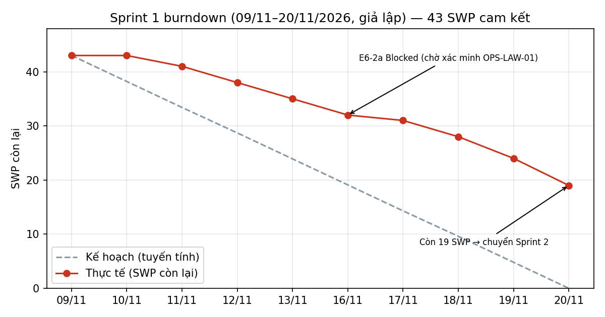

# Progress report — Sprint 1

**Iteration trên Project**: `Sprint 1` · **Thời gian giả lập**: 09/11/2026 – 20/11/2026 (10 ngày làm việc)
Cam kết đầu sprint: **16 issue / 43 SWP**. Đội giả định: BE-1, BE-2, FE-1, QA-1, BrSE-1 (G-06).

## 1. Trạng thái
| Trạng thái | Số issue | Tổng SWP | Ghi chú |
|---|---|---|---|
| Done | 11 | 24 | Nền tảng đăng nhập, phân quyền, audit, CI; 4/5 bước engine phân bổ; SKU; 拘束 13/15h |
| In Review | 2 | 7 | {{#E4-2d}} (review phát hiện thiếu test bản ghi đảo — đang bổ sung), {{#E9-1}} |
| In Progress | 2 | 7 | {{#E6-1}} màn version luật; {{#E6-5}} chờ khách trả lời |
| Blocked | 1 | 5 | {{#E6-2a}} chờ kết luận OPS-LAW-01 về cộng dồn nghỉ |
| **Tổng Sprint 1** | **16** | **43** | Hoàn thành 24 / 43 SWP (56%) |

Toàn backlog sau Sprint 1: Done 11 issue / 24 SWP · còn lại 42 issue / 189 SWP (Sprint 2–6).

## 2. Burndown

| Ngày | 09/11 | 10/11 | 11/11 | 12/11 | 13/11 | 16/11 | 17/11 | 18/11 | 19/11 | 20/11 |
|---|---|---|---|---|---|---|---|---|---|---|
| Kế hoạch | 43.0 | 38.2 | 33.4 | 28.7 | 23.9 | 19.1 | 14.3 | 9.6 | 4.8 | 0.0 |
| Thực tế | 43 | 43 | 41 | 38 | 35 | 32 | 31 | 28 | 24 | 19 |

**Lệch kế hoạch ở đâu**
- **Ngày 1–2 phẳng**: đội dựng CI và migration trước ({{#E9-3}}, {{#E9-1}}), chưa đóng issue nghiệp vụ nào — điểm “kế hoạch tuyến tính” giả định đóng việc đều mỗi ngày, thực tế không như vậy.
- **Từ 16/11 tách xa**: {{#E6-2a}} (5 SWP) bị chặn vì cách hiểu “cộng dồn nghỉ” chưa được khách xác nhận; {{#E4-2d}} (5 SWP) bị trả lại ở review vì thiếu test cho bản ghi đảo (PREMISE P1-2).
- **Cuối sprint còn 19 SWP** (44%) chuyển Sprint 2. Velocity thực tế Sprint 1: **24 SWP** — thấp hơn giả định 40 SWP/sprint (G-06), cần điều chỉnh kế hoạch Sprint 2.

## 3. Rủi ro trễ
| Rủi ro | Issue | Ảnh hưởng tới mốc nào | Hành động | Ai làm, khi nào |
|---|---|---|---|---|
| Chưa có kết luận pháp lý về cộng dồn nghỉ (OPS-LAW-01) | {{#E6-2a}}, {{#E6-5}} | Mốc “Lập tuyến tuân thủ 2024 demo được” cuối Sprint 3 (18/12) | Gửi câu hỏi kèm 2 phương án cho khách; làm trước theo G-02 với tham số để đổi không sửa code | BrSE-1 gửi trước 24/11; BE-2 hoàn thành theo G-02 trong Sprint 2 |
| Velocity Sprint 1 = 24 SWP, thấp hơn kế hoạch 40 | Toàn bộ Sprint 2–6 | Mốc kết thúc Sprint 6 (29/01/2027) có thể lùi 1 sprint | Sprint 2 cam kết tối đa 32 SWP (19 chuyển + 13 mới, rút {{#E2-3}} / {{#E3-1a}} sang Sprint 3); đo lại velocity sau Sprint 2 | PL, họp lập kế hoạch 23/11 |
| Review phát hiện thiếu test ở engine phân bổ | {{#E4-2d}}, {{#E4-3}} | Mốc “Phân bổ hoàn chỉnh” cuối Sprint 2 (04/12) | Thêm checklist review: mỗi quy tắc đặc thù phải có test case R-06 + ca biên trước khi chuyển In Review | BE-1 sửa trước 25/11; PL cập nhật DoD 23/11 |
| Dữ liệu chấm công cho giờ tích lũy tháng / năm chưa có đặc tả | {{#E6-2e}} | Sprint 5 (15/01/2027) | Yêu cầu khách mẫu file chấm công trước Sprint 3; nếu không có, giữ mock và ghi rõ trong release note | BrSE-1, trước 07/12 |
| Nghỉ cuối năm giảm capacity Sprint 4 | Issue Sprint 4 | Sprint 4 (01/01/2027) | Kế hoạch 30 SWP (G-07); không đặt issue đặc thù 2024 vào Sprint 4 | PL, lập kế hoạch 21/12 |
